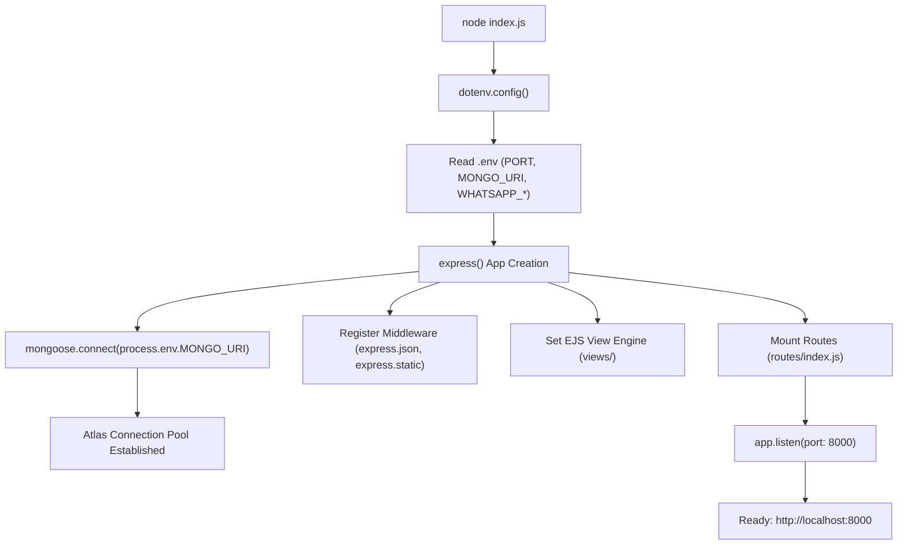

# Database Phone Numbers Audit & Application Runtime Guide

**Project**: [Perfect Collection Transaction Database](file:///Users/paraskaushik/Developer/PerfectCollectionTransactionDatabase/README.md)  
**Date**: October 15, 2026  
**Audience**: Junior Developer / Engineering Reference  
**Scope**: MongoDB Phone Number Audit, Deduplication Analysis, Schema Best Practices, and Local Development Runtime Guide  

---

## 1. Executive Summary

A comprehensive audit was performed on the production MongoDB Atlas database (`cluster0.omsux.mongodb.net/perfectCollectionDb`) to determine the exact number of unique customer phone numbers and understand database consistency.

### Key Metrics Summary

| Metric | Count | Technical Notes |
| :--- | :---: | :--- |
| **Total Transactions Recorded** | **274** | Complete document count in the `transactions` collection |
| **Transactions with Phone Entry** | **273** | Documents where `phoneNumber` is populated |
| **Transactions without Phone Entry** | **1** | Document with missing/null phone number |
| **Unique Raw Strings in Database** | **116** | Unprocessed distinct values returned by `Transaction.distinct("phoneNumber")` |
| **Truly Unique Valid 10-Digit Phone Numbers** | **114** | Unique numbers after normalizing spaces, prefixes, and country codes |
| **Estimated Real Customer Numbers** | **~111** | Deduplicated numbers excluding the shop's own number and test fixtures |

---

## 2. Discrepancy & Root Cause Analysis (116 Raw vs. 114 Clean)

Why does `distinct("phoneNumber")` report **116** while the real unique count is **114**?

```
Raw Strings in DB (116)
  ├── 1x Sentinel Entry: "NA" (Non-numeric text)
  ├── 1x Whitespace Variant: "99713 13547" vs "9971313547" (Same number, different string bytes)
  └── 114x Valid, Unique 10-Digit Mobile Numbers
```

### Root Cause 1: Whitespace Inconsistency
* The customer phone number `9971313547` was entered once as `"99713 13547"` (with an embedded space) and 6 times as `"9971313547"` (without spaces).
* **Technical Reason**: In MongoDB, string comparisons use binary BSON byte comparison (`===`). ASCII `0x20` (space) makes `"99713 13547"` completely distinct from `"9971313547"`. Without a schema sanitization rule, both values sit alongside each other as separate keys in the collection index.

### Root Cause 2: Non-Numeric Sentinel Strings
* One record was saved with the literal string `"NA"`.
* **Technical Reason**: In early versions of the POS screen, operators typed `"NA"` when a customer declined to provide a number. Because `phoneNumber` was typed as generic `String` in [models/transaction.js](file:///Users/paraskaushik/Developer/PerfectCollectionTransactionDatabase/models/transaction.js), Mongoose allowed this arbitrary string through without raising a validation error.

### Root Cause 3: Missing Field Record
* Exactly **1** transaction document in the database has no `phoneNumber` property or has it set to `null`/empty.

---

## 3. Customer Transaction Frequency & Volume Insights

Analyzing transaction volume across the 114 unique numbers reveals distinct customer segments:

| Visit Frequency | Customer Count | Notes |
| :---: | :---: | :--- |
| **1 transaction** | **103** | First-time or single-visit retail shoppers |
| **2 transactions** | **8** | Returning repeat customers |
| **7 transactions** | **1** | Highly loyal customer (`9971313547`) |
| **44 transactions** | **1** | Top frequent buyer (`9911782743`) |
| **102 transactions** | **1** | **Store Owner / Default Contact (`9899258797`)** |

### Top Phone Numbers by Transaction Volume

1. **`9899258797` — 102 Transactions**:
   * This is the store's primary contact number as configured in [services/pdfGenerator.js:67](file:///Users/paraskaushik/Developer/PerfectCollectionTransactionDatabase/services/pdfGenerator.js#L67). When a walk-in customer declines to provide a phone number, or during store operator testing, this number is inputted.
2. **`9911782743` — 44 Transactions**:
   * Top commercial/frequent retail customer of the shop.
3. **`9971313547` — 7 Transactions**:
   * Regular repeat customer (the one entered with mixed whitespace).
4. **Test Numbers**:
   * `1111111111` (2 transactions) — dummy QA test entry.
   * `1234567890` (2 transactions) — dummy QA test entry.

---

## 4. Technical Education for Junior Developers

### Concept A: Why Did Dirty Data Enter the Database?

Inspect the existing schema definition inside [`models/transaction.js`](file:///Users/paraskaushik/Developer/PerfectCollectionTransactionDatabase/models/transaction.js#L13-L15):

```javascript
phoneNumber: {
  type: String,
}
```

#### What Was Missing?
1. **No Data Normalization (Setter)**: The input was saved as sent by the client. If an operator accidentally added a leading space, trailing space, or middle space, it persisted straight to the database.
2. **No Schema-Level Validation**: The schema didn't reject strings containing non-digit characters like `"NA"`.
3. **The Layer Fallacy**: While client-side JavaScript ([assets/js/pdf.js](file:///Users/paraskaushik/Developer/PerfectCollectionTransactionDatabase/assets/js/pdf.js)) was recently updated in v1.1.0 to strip non-digits, relying **only** on client-side validation is an anti-pattern. Historical data entered before the fix remains dirty, and any direct API calls (e.g. Postman, curl, internal test scripts) bypass frontend checks completely.

---

### Concept B: Best Practice — Enforcing Clean Data in Mongoose

In professional backend engineering, always enforce data constraints at the **Model level**. Mongoose provides built-in `trim`, custom `set` transformation functions, and regex validators.

#### Proposed Model Enhancement for [`models/transaction.js`](file:///Users/paraskaushik/Developer/PerfectCollectionTransactionDatabase/models/transaction.js)

```javascript
phoneNumber: {
  type: String,
  trim: true,
  // Automatically sanitize on every save/update:
  set: function(val) {
    if (!val) return val;
    // Strip all non-numeric characters (spaces, dashes, parens)
    let digits = val.replace(/\D/g, "");
    // If entered with India country code +91 or 91, extract the 10 digits
    if (digits.length === 12 && digits.startsWith("91")) {
      digits = digits.slice(2);
    }
    // If entered with leading 0, strip it
    if (digits.length === 11 && digits.startsWith("0")) {
      digits = digits.slice(1);
    }
    return digits;
  },
  validate: {
    validator: function(v) {
      // Allow empty/null if phone is optional, but if present must be exactly 10 digits starting with 6-9
      return !v || /^[6-9]\d{9}$/.test(v);
    },
    message: props => `"${props.value}" is not a valid 10-digit Indian mobile number!`
  }
}
```

#### Syntax & Mechanics Breakdown
* `trim: true`: Automatically strips leading and trailing whitespace.
* `set: function(val)`: A Mongoose setter interceptor. Whenever code does `doc.phoneNumber = " 99713 13547 "`, Mongoose executes this function before writing to BSON, transforming the string into `"9971313547"`.
* `\D`: A regular expression character class matching any non-digit character (the inverse of `\d`).
* `/^[6-9]\d{9}$/`: Standard Indian telecom validation regex:
  * `^`: Beginning of the string.
  * `[6-9]`: First digit must be 6, 7, 8, or 9 (standard mobile allocation in India).
  * `\d{9}`: Exactly 9 following digits (total 10 digits).
  * `$`: End of string.

---

### Concept C: MongoDB Aggregation Pipeline vs. In-Memory Processing

When querying distinct values across large datasets, doing it inside Node.js memory vs. inside the MongoDB engine has massive architectural implications:

#### Approach 1: In-Memory Processing (What Our Scratch Script Did)
```javascript
// Fetches all 274 documents over the network into Node.js V8 Heap
const docs = await Transaction.find({}, { phoneNumber: 1 }).lean();
const cleanSet = new Set();
for (const doc of docs) {
  if (doc.phoneNumber) {
    cleanSet.add(doc.phoneNumber.replace(/\D/g, ""));
  }
}
console.log(cleanSet.size);
```
* **Pros**: Simple to write; easy to debug edge cases in JavaScript.
* **Cons**: Consumes network bandwidth and server RAM proportional to total collection size ($O(N)$). If the database grows to 500,000 transactions, this will trigger an Out Of Memory (`OOM`) crash on low-tier servers like Render.com.

#### Approach 2: Database-Side Aggregation Pipeline (Production Standard)
```javascript
const result = await Transaction.aggregate([
  // Stage 1: Exclude null, empty string, or known sentinels
  { 
    $match: { 
      phoneNumber: { $exists: true, $nin: [null, "", "NA"] } 
    } 
  },
  
  // Stage 2: Transform string directly within MongoDB
  {
    $project: {
      cleanPhone: {
        $replaceAll: { input: "$phoneNumber", find: " ", replacement: "" }
      }
    }
  },
  
  // Stage 3: Group by cleaned phone (deduplication)
  { 
    $group: { 
      _id: "$cleanPhone", 
      transactionCount: { $sum: 1 } 
    } 
  },
  
  // Stage 4: Count total distinct keys
  { 
    $count: "uniquePhoneCount" 
  }
]);
```
* **Pros**: Executed natively in C++ inside MongoDB Atlas engine. Transfers only **1 small JSON object** back over the network (`{ "uniquePhoneCount": 114 }`). Memory usage in Node.js is $O(1)$.
* **Cons**: Requires familiarity with MongoDB Aggregation syntax and operators (`$match`, `$project`, `$group`, `$replaceAll`).

---

## 5. Local Development Runtime Guide

### What Happens When You Boot the App?

Execution begins at [`index.js`](file:///Users/paraskaushik/Developer/PerfectCollectionTransactionDatabase/index.js):



### Essential Developer Commands

#### 1. Start Server for Development (Recommended)
```bash
npx nodemon index.js
```
* Automatically watches all `.js`, `.ejs`, and `.json` files and restarts upon saving.

#### 2. Start Server for Production
```bash
npm start
```
* Invokes `node index.js` without file watchers.

#### 3. Verify Server Status via Terminal
```bash
curl -I http://localhost:8000
```
* Expected response: `HTTP/1.1 200 OK`

#### 4. Managing Port Conflicts
If port 8000 is occupied or fails to release:
```bash
# Find Process ID (PID)
lsof -i :8000

# Terminate process
kill -9 <PID>
```

---

## 6. Key Application Routes

| Endpoint | View Template | Purpose |
| :--- | :--- | :--- |
| `GET /` | [`views/home.ejs`](file:///Users/paraskaushik/Developer/PerfectCollectionTransactionDatabase/views/home.ejs) | Main POS Billing interface for entering items & phone numbers |
| `POST /transaction/create` | *API Endpoint* | Saves transaction in MongoDB, generates PDF, triggers WhatsApp API |
| `GET /users/profile` | [`views/user_profile.ejs`](file:///Users/paraskaushik/Developer/PerfectCollectionTransactionDatabase/views/user_profile.ejs) | Daily sales ledger displaying invoices, amounts, and customer phones |
| `GET /users/month` | [`views/month.ejs`](file:///Users/paraskaushik/Developer/PerfectCollectionTransactionDatabase/views/month.ejs) | 30-day sales analytics chart rendered using Chart.js |
